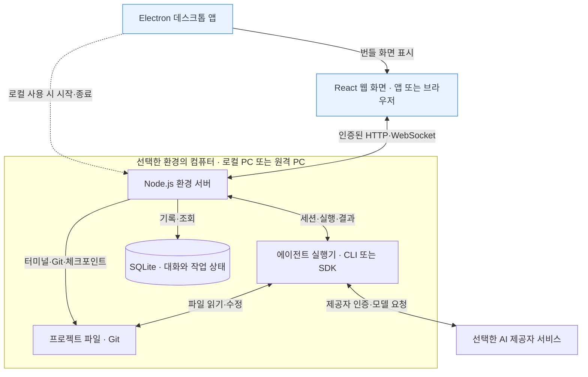
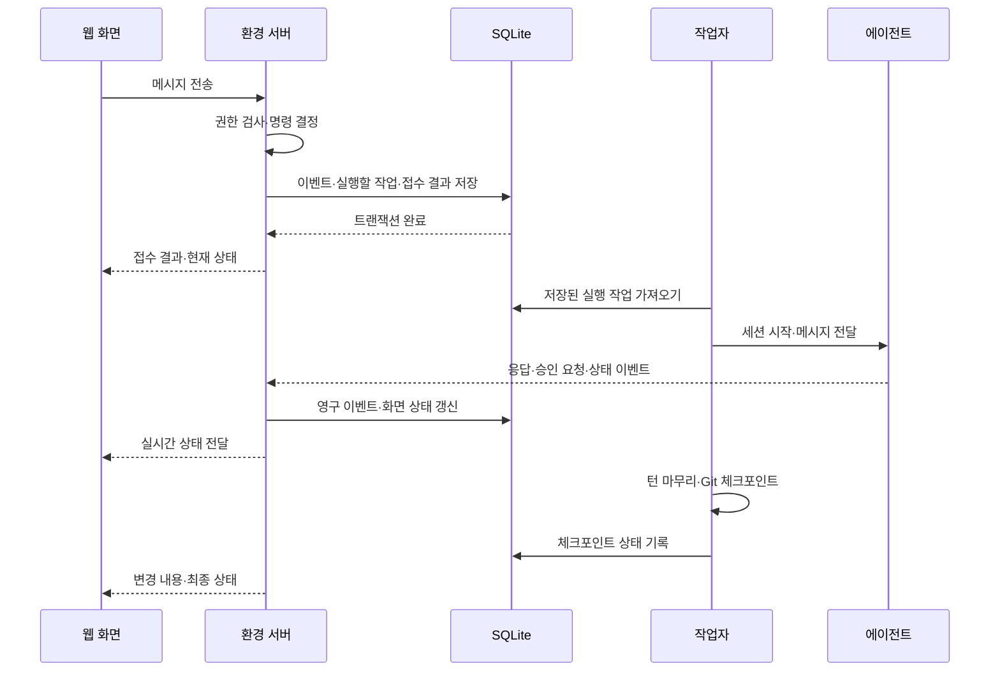
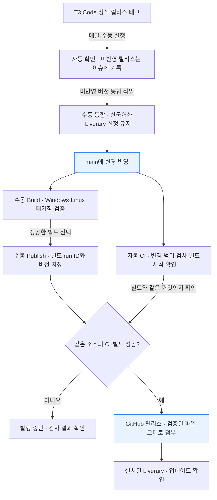

# Liverary

Liverary는 에이전트와 지식이 함께 자라는 ‘살아 있는 도서관’이라는 뜻을 담았습니다. [T3 Code](https://github.com/pingdotgg/t3code)를 기반으로 한 한국어 중심의 개인 작업 공간으로, Electron 데스크톱 앱과 로컬 웹 화면을 함께 제공합니다.

**설치 파일:** [최신 릴리스 다운로드](https://github.com/andongmin94/t3-custom/releases/latest)

현재 기반 버전은 **T3 Code v0.1.6** (`2359643cffa6ba9ee84d6f2694b935de54a8013e`)입니다. 원본 Git 이력을 유지하므로 이후 안정 버전도 병합해 신기능과 수정 사항을 반영할 수 있습니다.

[전체 구조](#전체-구조) · [메시지 처리 순서](#메시지-처리-순서) · [설치 파일 빌드·발행하기](#설치-파일-빌드발행하기) · [원본 신기능 반영하기](#원본-신기능-반영하기)

## 전체 구조

**Liverary는 에이전트를 조작하는 화면과, 실제 작업을 수행하는 환경 서버로 나뉩니다.** 기본 데스크톱 실행에서는 둘 다 내 컴퓨터에서 실행됩니다. 원격 환경을 연결하면 파일·터미널·에이전트·대화 DB는 그 원격 컴퓨터의 것을 사용합니다.



데스크톱은 번들에 들어 있는 웹 화면을 `t3custom://app/`으로 열고, 별도 프로세스로 로컬 서버를 실행합니다. 브라우저로 실행해도 같은 웹 UI와 환경별 통신 계층을 사용합니다. **T3 Connect 계정 없이 로컬에서 쓸 수 있지만, 앱과 서버 사이의 인증 및 AI 제공자 인증은 유지됩니다.**

### 코드에서 각 부분을 찾으려면

| 부분             | 위치                                                                                                               | 담당하는 일                                      |
| ---------------- | ------------------------------------------------------------------------------------------------------------------ | ------------------------------------------------ |
| 화면·한국어·테마 | [`apps/web`](apps/web), [`locales/ko`](apps/web/src/locales/ko)                                                    | 대화, 설정, 프로젝트 화면과 Liverary 표시        |
| 데스크톱 껍데기  | [`apps/desktop`](apps/desktop)                                                                                     | 창·메뉴, 로컬 서버 시작, OS 연동, 앱 업데이트    |
| 환경 서버        | [`apps/server`](apps/server)                                                                                       | 요청 권한 검사, 작업 순서, 대화 저장, 터미널·Git |
| 에이전트 연결    | [`packages/provider-core`](packages/provider-core), `packages/provider-*`                                          | 제공자별 프로토콜을 공통 세션·이벤트로 연결      |
| 공통 연결·계약   | [`packages/client-runtime`](packages/client-runtime), [`packages/contracts`](packages/contracts)                   | 환경별 연결과 화면 상태, 요청·이벤트 형식        |
| 설치 파일·배포   | [`.github/workflows`](.github/workflows), [`scripts/build-desktop-artifact.ts`](scripts/build-desktop-artifact.ts) | 패키징, 검증, GitHub 릴리스 발행                 |

## 메시지 처리 순서

메시지를 보내면 서버가 먼저 **무엇을 실행할지 기록**하고, 작업자가 그 기록을 읽어 에이전트를 실행합니다. 아래 서버·저장소·작업자는 논리적인 역할 구분이며, 별도 서버 세 대를 설치하는 구조가 아닙니다.



**접수 성공은 작업 완료와 다릅니다.** 실행 중 응답과 상태가 계속 전달되고, 파일 변경 내역이나 체크포인트는 턴 종료 뒤 마무리됩니다. 대량 명령 출력의 일부는 별도 실시간 스트림으로 전달하므로 모든 출력 조각이 DB에 저장되는 것은 아닙니다. 다시 연결하면 저장된 스냅샷·이벤트로 화면 상태를 복원합니다.

기본 로컬 환경의 주요 저장 위치는 다음과 같습니다. `T3CODE_HOME`이나 `--home-dir`을 지정하면 기준 폴더가 달라집니다.

| 데이터                | 기본 위치                                                                 |
| --------------------- | ------------------------------------------------------------------------- |
| 대화·작업 상태        | `~/.t3-custom/userdata/statev2.sqlite`                                    |
| 첨부·로그·서버 설정   | `~/.t3-custom/userdata/` 아래 `attachments/`, `logs/`, `settings.json` 등 |
| 자동 생성한 작업 트리 | `~/.t3-custom/worktrees/`                                                 |
| 원래 프로젝트 파일    | 사용자가 선택한 프로젝트 폴더                                             |
| Git 체크포인트        | 해당 프로젝트 Git 저장소의 `refs/t3/orchestration-v2/checkpoints/` 아래   |
| 데스크톱 프로필       | OS 앱 데이터 폴더의 `t3-custom`                                           |

Git 체크포인트는 사용자 브랜치에 커밋을 추가하지 않는 숨은 Git 참조이며, Git 저장소가 아닌 폴더에서는 캡처가 생략됩니다. 원격 환경에서는 서버 데이터와 프로젝트 파일이 **원격 컴퓨터**에 있습니다.

구현 근거: [데스크톱 시작](apps/desktop/src/app/DesktopApp.ts), [요청·구독](apps/server/src/ws.ts), [Orchestrator](apps/server/src/orchestration-v2/Orchestrator.ts), [이벤트 저장](apps/server/src/orchestration-v2/EventSink.ts), [작업자](apps/server/src/orchestration-v2/EffectWorker.ts), [제공자 이벤트 수신](apps/server/src/orchestration-v2/ProviderEventIngestor.ts).

## 변경 사항

- Liverary 이름·심볼·앱 아이콘, 화이트·중립 회색·블루 중심의 밝은 테마와 차콜 다크 테마를 사용합니다. 직접 선택한 테마·글꼴은 유지합니다.
- 첫 실행, 프로젝트·대화 사이드바, 명령 팔레트, 주요 설정, 대화 입력·승인·작업 안내, 데스크톱 메뉴를 한국어로 표시합니다. 번역은 `apps/web/src/locales/ko/`에 모았습니다.
- 날짜와 상대 시간을 한국어로 표시합니다. 시간대와 12/24시간 선택은 유지합니다.
- 기본 빌드는 T3 Connect 계정 없이 로컬에서 실행합니다. `.env.example`과 빌드 워크플로의 Clerk·relay 설정은 비어 있습니다.
- 표시 이름은 Liverary이며, 기존 설치와의 연속성을 위해 T3 Custom의 앱 식별자·데이터 폴더·업데이트 저장소를 유지합니다. 서버 데이터는 `~/.t3-custom`, Electron 프로필은 OS 앱 데이터 폴더의 `t3-custom`을 사용합니다.
- 원본 앱의 프로필이나 대화 기록을 자동으로 가져오지 않습니다. 데스크톱 연결 주소는 `t3custom://`입니다.
- T3 사용 통계는 실행 시 기본으로 꺼져 있으며, 원본 저장소 별표 요청을 표시하지 않습니다. 재설치와 오류 신고 링크도 커스텀 저장소를 사용합니다.
- 앱 정보의 공식 T3 모바일 앱 설치 안내를 제거했습니다. AI 제공자와 실제 외부 GitHub App의 이름·권한 표시는 그대로 유지합니다.

한국어화 대상은 데스크톱과 로컬 웹의 주요 사용 화면입니다. 일부 고급 화면, 에이전트·서버에서 전달하는 메시지, 릴리스 노트, 문서, 모바일 앱은 영어가 남아 있습니다.

### 로그인 구분

**T3 Connect 로그인은 로컬 사용에 필요하지 않습니다.** 원격 접속·클라우드 기능을 쓰려면 별도 구성이 필요합니다. 네트워크 인증과 접근 제어는 유지됩니다.

**AI 제공자 인증은 필요합니다.** Codex·Claude 등의 계정이나 API 키는 해당 제공자의 실행 조건이며, 앱의 표시 언어와 별개입니다. 이미 설정한 CLI 인증을 사용하거나 첫 실행 화면에서 제공자를 연결하세요.

## 개인정보 및 외부 연결

**v1.0.1부터 T3 사용 통계가 실행 시 기본으로 꺼져 있습니다.** 별도로 `T3CODE_TELEMETRY_ENABLED=true`를 지정하지 않으면 T3 통계 서버로 이벤트를 보내지 않으며, 서버가 통계 전용 설치 ID(`anonymous-id`)를 만들거나 제공자 계정 정보를 통계 목적으로 읽지 않습니다. AI 제공자를 사용하기 위한 정상적인 인증 정보 접근은 유지됩니다.

v1.0.0은 빌드 환경에서만 통계를 꺼 두어 설치된 앱에서는 원본의 통계 기본값이 적용될 수 있었습니다. v1.0.0을 설치했다면 최신 커스텀 릴리스로 업데이트하세요. 통계를 명시적으로 켜면 앱·운영체제 정보, 기능 사용과 제공자·모델·토큰 사용량, 해시 처리한 설치·계정 식별값 등이 T3의 통계 수집 서버로 전달될 수 있습니다.

| 연결                     | 기본 동작                                                                                                                  |
| ------------------------ | -------------------------------------------------------------------------------------------------------------------------- |
| T3 Connect 계정·클라우드 | 기본 빌드는 연결 설정이 비어 있어 로컬 사용에 필요하지 않습니다.                                                           |
| T3 사용 통계             | 기본 꺼짐. 설정하지 않은 경우에도 전송과 서버의 통계 전용 계정 조회·설치 ID 생성을 시작하지 않습니다.                      |
| 원본 저장소 별표 요청    | 자동 별표 여부 확인과 요청 창을 제거했습니다.                                                                              |
| AI 제공자                | 선택한 제공자로 요청과 작업에 필요한 데이터가 전달됩니다. 제공자의 인증·요금·데이터 처리 조건이 적용됩니다.                |
| 앱 업데이트              | 이 커스텀 저장소의 GitHub 릴리스를 확인합니다.                                                                             |
| 모델 목록·가격 정보      | 원본 프로젝트 등의 공개 GitHub 자료를 내려받는 기능을 유지합니다. 이 요청에 대화 본문이나 소스 파일을 업로드하지 않습니다. |
| 진단 내보내기            | 사용자가 OTLP 수신 주소를 직접 설정했을 때만 해당 주소로 내보냅니다. T3 사용 통계 설정과는 별개입니다.                     |

로그와 대화 기록은 로컬 데이터 폴더에 저장되지만, AI 요청·사용자가 설정한 원격 환경·외부 도구는 네트워크를 사용합니다. 모든 데이터가 로컬에만 남는 오프라인 앱은 아닙니다.

브라우저의 기기 식별값과 해시 처리한 연결 메타데이터는 로컬 서버나 사용자가 선택한 원격 서버로 전달될 수 있습니다. 기본 설정에서는 이를 T3 통계 서버로 중계하지 않습니다. 원격 서버를 쓰는 경우에는 해당 서버 운영자의 설정도 적용됩니다.

선택 기능인 문제 진단(`triage`)은 사용자가 실행하면 원본 소스·이슈를 조회하고 선택한 AI 제공자와 진단 자료를 다룰 수 있습니다. 원본 이슈 게시 전에는 내용을 보여 주고 승인을 받도록 안내합니다. Codex 대화의 `/feedback` 명령은 사용자가 직접 실행할 때 로그를 포함한 피드백을 OpenAI로 보냅니다. 일반적인 대화만으로 이 기능들이 자동 실행되지는 않습니다.

## 소스에서 실행

[Vite+](https://viteplus.dev/guide/)의 `vp`를 설치합니다. Node.js와 패키지 매니저 버전은 루트 `package.json`을 따릅니다.

```bash
git clone https://github.com/andongmin94/t3-custom.git
cd t3-custom
vp install --frozen-lockfile
```

기본 로컬 실행에는 `.env`가 필요하지 않습니다. 설정을 명시하려면 `.env.example`을 `.env`로 복사합니다.

```bash
# 개발용 데이터 폴더를 지정한 데스크톱 실행
vp run dev:desktop --home-dir ./.t3-custom-dev

# 브라우저에서 로컬 개발 화면 실행
vp run dev --home-dir ./.t3-custom-dev

# 배포용 애플리케이션 번들 빌드
vp run build:desktop
```

Linux에서 네이티브 자격 증명 도우미를 빌드하려면 `libsecret-1-dev`와 `pkg-config`가 필요합니다. 설치 파일은 아래 수동 빌드에서 만듭니다.

## 설치 파일 빌드·발행하기

원본 업데이트를 가져오는 일과 사용자에게 설치 파일을 배포하는 일은 다음처럼 이어집니다.



**원본 릴리스 확인은 자동이며, 통합·한국어화와 두 배포 워크플로 실행은 관리 작업입니다.** `main`에 푸시하면 CI가 자동 실행됩니다. 이 커스텀 CI는 변경 범위 검사, 데스크톱 빌드와 빌드된 웹 시작 검사를 수행하며, 저장소 전체 테스트를 매번 실행하는 구성은 아닙니다.

GitHub Actions에서 다음 두 워크플로를 수동으로 실행합니다. [기존 릴리스](https://github.com/andongmin94/t3-custom/releases)를 확인하고 아직 사용하지 않은 새 `X.Y.Z` 버전을 입력합니다. 원본의 `v0.1.x` 태그와 커스텀 릴리스 버전을 구분합니다. 이미 발행한 버전은 의존성 설치·빌드 전에 거부합니다.

1. **Build Liverary desktop → Run workflow**에서 `main`과 커스텀 버전을 선택합니다. 빌드·검증이 성공하면 실행 URL의 숫자 run ID를 확인합니다.
2. **Publish Liverary release → Run workflow**에 성공한 빌드의 run ID, 같은 버전, 이번 변경 사항의 한국어 요약을 입력합니다. 빌드와 같은 소스 커밋의 최신 CI 실행도 성공해야 합니다. 해당 실행의 검증된 아티팩트를 그대로 가져와 입력한 버전 태그의 GitHub 릴리스로 발행합니다. 발행 단계에서는 다시 빌드하지 않습니다.

워크플로는 Windows x64 설치 파일, Linux x64 AppImage·deb, CLI 압축 파일과 업데이트 메타데이터를 `t3-custom-<버전>` 아티팩트로 묶습니다. 아티팩트 보관 기간은 7일입니다. macOS 설치 파일은 이 워크플로에 포함되지 않습니다.

발행 워크플로는 설치 파일과 함께 자동 업데이트에 필요한 `latest.yml`, `latest-linux.yml`, blockmap, CLI 압축 파일과 `SHA256SUMS`를 첨부합니다. 자체 서명 인증서를 설정하지 않은 설치 파일은 운영체제에서 확인을 요구할 수 있습니다.

사용자는 [최신 릴리스](https://github.com/andongmin94/t3-custom/releases/latest)에서 설치 파일을 받습니다. 설치된 앱도 **이 저장소에 발행한 커스텀 릴리스**를 자동으로 확인합니다. 다운로드와 적용은 사용자가 시작하고, 적용 확인 뒤 앱이 다시 실행됩니다.

## 원본 신기능 반영하기

### 세션이 닫힌 뒤에도 유지되는 확인

[Check T3 Code releases](https://github.com/andongmin94/t3-custom/actions/workflows/check-upstream.yml)가 매일 한국 시간 **09:23**에 최신 정식 릴리스를 확인하도록 예약되어 있습니다. [GitHub 예약 실행](https://docs.github.com/en/actions/reference/workflows-and-actions/events-that-trigger-workflows#schedule)은 지연되거나, 공개 저장소에 60일 동안 활동이 없으면 비활성화될 수 있습니다. 즉시 확인하려면 같은 화면에서 **Run workflow**를 실행합니다.

원본 릴리스가 `main` 이력에 아직 포함되지 않았으면 [Issues](https://github.com/andongmin94/t3-custom/issues)에 통합 대상과 작업 링크를 남깁니다. 기존 관리 이슈를 갱신하므로 매일 같은 이슈를 새로 만들지 않습니다. 반영되면 다음 확인 때 이슈를 닫으며, API 오류를 반영 완료로 처리하지 않습니다. 이미 반영된 경우에는 Actions 실행 요약에 결과만 남깁니다.

이 확인에는 별도 API 키나 이 대화 세션이 필요하지 않습니다. 자동 병합·번역·발행은 하지 않습니다. **다른 세션에서 이어갈 때는 이 저장소와 통합 이슈를 전달하고, `AGENTS.md`와 이 README의 절차에 따라 한국어화·검증·발행까지 진행하도록 요청하면 됩니다.**

### 정식 릴리스 통합

이 저장소는 `main` 브랜치 하나로 관리합니다. 원본 업데이트도 `main`에 병합하며, 별도의 작업·업데이트 브랜치를 유지하지 않습니다.

업데이트는 **원본 정식 릴리스 태그 단위**로 통합합니다. 개발 중인 `main`의 커밋을 하나씩 따라가지 않습니다. 해당 릴리스의 변경을 통합한 뒤 Liverary 브랜딩·로컬 실행 설정과 한국어화를 맞춥니다.

한 번만 원본 저장소를 등록합니다. 원본 태그는 `upstream/` 아래로 가져와 커스텀 릴리스 태그와 겹치지 않게 합니다.

```bash
git remote add upstream https://github.com/pingdotgg/t3code.git
git fetch upstream 'refs/tags/*:refs/tags/upstream/*'
```

원하는 안정 버전을 확인한 뒤, 작업 트리가 깨끗한 상태에서 병합합니다. 아래 `v0.1.6` 자리를 새 원본 릴리스 태그로 바꾸세요.

```bash
git switch main
git pull --ff-only origin main
git fetch upstream 'refs/tags/*:refs/tags/upstream/*'
git merge upstream/v0.1.6
```

충돌이 생기면 번역·앱 식별자·업데이트 저장소·로컬 실행 설정·통계 기본 꺼짐을 유지하면서 원본 변경을 반영합니다. 원본 워크플로가 다시 추가되었는지도 확인합니다. 업데이트 완료 범위에는 추가·변경된 데스크톱·로컬 웹 UI 문구의 한국어화도 포함됩니다. 기존 `apps/web/src/locales/ko/` 모듈과 관련 표시 문구·테스트를 함께 갱신합니다.

통합한 변경을 기준으로 변경 범위 검사와 데스크톱 빌드를 한 번 수행합니다.

```bash
vp install --frozen-lockfile
vp run check:changed origin/main
vp run build:desktop
git push origin main
```

README의 기반 버전을 갱신하고 커스텀 버전을 올려 설치 파일을 다시 빌드·발행합니다. 원본 설치 파일을 그대로 받아서는 이 저장소의 한국어화와 커스텀 설정이 포함되지 않습니다.

## 개발 및 라이선스

CI는 일반 GitHub 러너에서 변경 파일 검사와 데스크톱 빌드를 수행합니다. 원본의 운영 서비스 배포, 모바일 발행, 이슈 관리, 예약 작업은 이 커스텀 워크플로에서 실행하지 않습니다.

자세한 원본 구조는 [docs/internals/overview.md](docs/internals/overview.md), 개발 규칙은 [AGENTS.md](AGENTS.md)를 참고하세요. 원본 문서의 다운로드 주소와 배포 방법은 T3 Code용일 수 있으므로, Liverary 설치·업데이트에는 이 README를 따릅니다.

원본 저작권과 [MIT LICENSE](LICENSE)를 유지합니다. Liverary는 T3 Code의 공식 배포판이 아닙니다.
