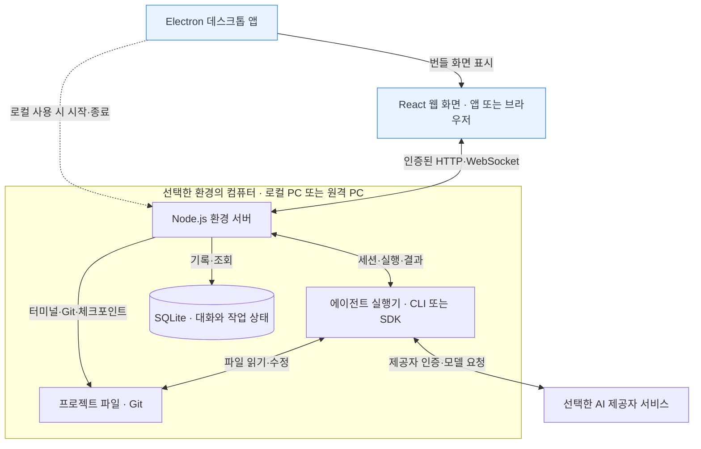
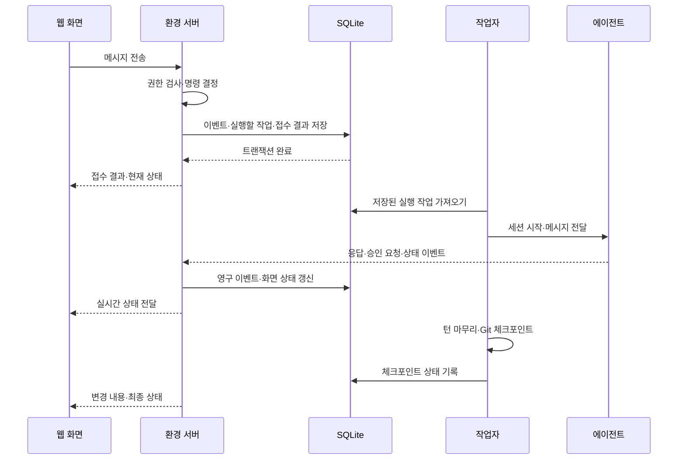
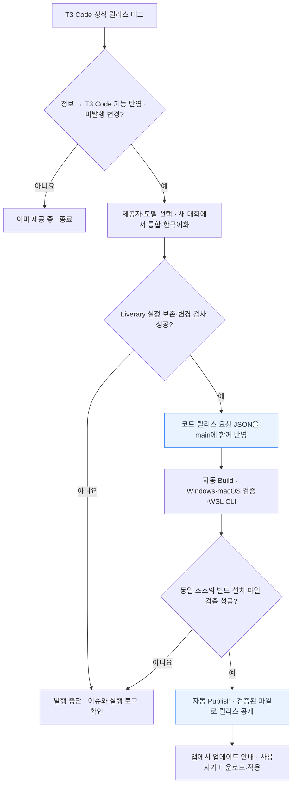

# Liverary

Liverary는 에이전트와 지식이 함께 자라는 ‘살아 있는 도서관’이라는 뜻을 담았습니다. [T3 Code](https://github.com/pingdotgg/t3code)를 기반으로 한 한국어 중심의 개인 작업 공간으로, Electron 데스크톱 앱과 로컬 웹 화면을 함께 제공합니다.

**설치 파일:** [최신 릴리스 다운로드](https://github.com/andongmin94/Liverary/releases/latest)

현재 기반 버전은 **T3 Code v0.1.9** (`24e77473ecf41bc1f7142529c7911c1c1aae1d76`)입니다. 원본 Git 이력을 유지하므로 이후 안정 버전도 병합해 신기능과 수정 사항을 반영할 수 있습니다.

[전체 구조](#전체-구조) · [메시지 처리 순서](#메시지-처리-순서) · [설치 파일 빌드·발행하기](#설치-파일-빌드발행하기) · [원본 신기능 반영하기](#원본-신기능-반영하기)

## 전체 구조

**Liverary는 에이전트를 조작하는 화면과, 실제 작업을 수행하는 환경 서버로 나뉩니다.** 기본 데스크톱 실행에서는 둘 다 내 컴퓨터에서 실행됩니다. 원격 환경을 연결하면 파일·터미널·에이전트·대화 DB는 그 원격 컴퓨터의 것을 사용합니다.



데스크톱은 번들에 들어 있는 웹 화면을 `liverary://app/`으로 열고, 별도 프로세스로 로컬 서버를 실행합니다. 브라우저로 실행해도 같은 웹 UI와 환경별 통신 계층을 사용합니다. **개인 PC용 데스크톱·로컬 웹에는 앱 계정·사용자 프로필이 없습니다. 앱과 서버 사이의 인증 및 AI 제공자 인증은 유지됩니다.**

### 코드에서 각 부분을 찾으려면

| 부분             | 위치                                                                                                               | 담당하는 일                                      |
| ---------------- | ------------------------------------------------------------------------------------------------------------------ | ------------------------------------------------ |
| 화면·한국어·테마 | [`apps/web`](apps/web), [`locales/ko`](apps/web/src/locales/ko)                                                    | 대화, 설정, 프로젝트 화면과 Liverary 표시        |
| 데스크톱 껍데기  | [`apps/desktop`](apps/desktop)                                                                                     | 창·메뉴, 로컬 서버 시작, OS 연동, 앱 업데이트    |
| 환경 서버        | [`apps/server`](apps/server)                                                                                       | 요청 권한 검사, 작업 순서, 대화 저장, 터미널·Git |
| 에이전트 연결    | [`packages/provider-core`](packages/provider-core), `packages/provider-*`                                          | 제공자별 프로토콜을 공통 세션·이벤트로 연결      |
| 공통 연결·계약   | [`packages/client-runtime`](packages/client-runtime), [`packages/contracts`](packages/contracts)                   | 환경별 연결과 화면 상태, 요청·이벤트 형식        |
| 설치 파일·배포   | [`.github/workflows`](.github/workflows), [`scripts/build-desktop-artifact.ts`](scripts/build-desktop-artifact.ts) | 패키징, 검증, GitHub 릴리스 발행                 |

## 메시지 처리 순서

메시지를 보내면 서버가 먼저 **무엇을 실행할지 기록**하고, 작업자가 그 기록을 읽어 에이전트를 실행합니다. 아래 서버·저장소·작업자는 논리적인 역할 구분이며, 별도 서버 세 대를 설치하는 구조가 아닙니다.



**접수 성공은 작업 완료와 다릅니다.** 실행 중 응답과 상태가 계속 전달되고, 파일 변경 내역이나 체크포인트는 턴 종료 뒤 마무리됩니다. 대량 명령 출력의 일부는 별도 실시간 스트림으로 전달하므로 모든 출력 조각이 DB에 저장되는 것은 아닙니다. 다시 연결하면 저장된 스냅샷·이벤트로 화면 상태를 복원합니다.

기본 로컬 환경의 주요 저장 위치는 다음과 같습니다. `T3CODE_HOME`이나 `--home-dir`을 지정하면 Liverary의 데이터 폴더가 바뀝니다. Codex와 Claude Code의 세션 경로는 각 공급자의 홈 설정을 따릅니다.

| 데이터                       | 기본 위치                                                                |
| ---------------------------- | ------------------------------------------------------------------------ |
| 대화·작업 상태               | `~/.liverary/userdata/statev2.sqlite`                                    |
| 첨부·로그·서버 설정          | `~/.liverary/userdata/` 아래 `attachments/`, `logs/`, `settings.json` 등 |
| 기본 Codex 계정의 세션       | `~/.codex/`                                                              |
| 기본 Claude Code 계정의 세션 | `~/.claude/projects/`                                                    |
| 자동 생성한 작업 트리        | `~/.liverary/worktrees/`                                                 |
| 원래 프로젝트 파일           | 사용자가 선택한 프로젝트 폴더                                            |
| Git 체크포인트               | 해당 프로젝트 Git 저장소의 `refs/t3/orchestration-v2/checkpoints/` 아래  |
| 데스크톱 프로필              | OS 앱 데이터 폴더의 `liverary`                                           |

Codex를 추가하려면 설정에서 **AI 제공자 추가 → Codex → 직접 설정**을 선택하세요. CLI에 이미 로그인했다면 그 계정과 `~/.codex`의 대화를 그대로 사용합니다.

Codex와 Claude Code는 기본적으로 해당 컴퓨터의 데스크톱 앱이 설치한 CLI를 사용합니다. 데스크톱 CLI가 없으면 터미널의 `PATH`에서 `codex` 또는 `claude`를 찾습니다. 제공자 설정의 **실행 파일 경로**에서 발견된 CLI를 선택하거나 다른 실행 파일의 전체 경로를 직접 입력할 수 있습니다. 둘 다 없으면 시작 화면에서 설치를 선택하세요. 별도로 설치하려면 제공자 설정의 **별도 CLI 설치 → 설치 명령 보기**에서 명령을 확인할 수 있습니다.

자동 공유를 지원하는 제공자의 세션은 별도 가져오기 없이 Liverary에 표시됩니다. 같은 실행 환경과 제공자 계정·저장소를 사용해야 하며, 원래 앱에서 추가한 메시지도 같은 Liverary 대화에 반영합니다. Liverary에서 시작한 Codex 대화는 첫 메시지가 저장되면 같은 세션 ID로 Codex에서도 이어갈 수 있습니다. 실행 중인 세션은 한 앱에서 작업을 마친 뒤 다른 앱에서 이어 쓰세요.

Claude 데스크톱에서 이미 신뢰한 작업 폴더라면, Liverary에서 Claude 답변이 끝나고 잠시 입력이나 백그라운드 작업이 없을 때 같은 Claude 세션을 **Code** 탭으로 전달합니다. Codex에서 시작한 대화를 Claude로 전환한 경우도 포함합니다. 이때 Claude 창이 앞으로 나올 수 있습니다. 처음 쓰는 폴더처럼 자동 전달을 확인할 수 없는 경우에는 Liverary 대화에 **Claude에서 이어가기** 안내가 남습니다. 이 PC의 Liverary 데스크톱에서 **Claude 데스크톱 열기**를 누른 뒤, Code 입력창에 `/resume`을 입력하고 안내에 표시된 폴더의 대화를 선택하세요. Claude가 폴더 신뢰를 물으면 그때 확인하면 됩니다.

Git 체크포인트는 사용자 브랜치에 커밋을 추가하지 않는 숨은 Git 참조이며, Git 저장소가 아닌 폴더에서는 캡처가 생략됩니다. 원격 환경에서는 서버 데이터와 프로젝트 파일이 **원격 컴퓨터**에 있습니다.

저장소별 작업·아이콘·워크트리 기본값은 루트의 `liverary.json`에서 설정합니다. VCS 종류는 `.liverary/vcs.json`에서 선택할 수 있습니다. 기존 `t3.json`과 `.t3code/vcs.json`도 각각 새 이름의 파일이 없을 때 읽습니다. 두 파일의 값은 합치지 않으며, 새 파일의 JSON이나 권한이 잘못됐을 때 이전 설정으로 대신 처리하지 않습니다. `liverary.json`의 `$schema`는 같은 형식의 원본 T3 Code 스키마 주소를 사용할 수 있습니다.

구현 근거: [데스크톱 시작](apps/desktop/src/app/DesktopApp.ts), [요청·구독](apps/server/src/ws.ts), [Orchestrator](apps/server/src/orchestration-v2/Orchestrator.ts), [이벤트 저장](apps/server/src/orchestration-v2/EventSink.ts), [작업자](apps/server/src/orchestration-v2/EffectWorker.ts), [제공자 이벤트 수신](apps/server/src/orchestration-v2/ProviderEventIngestor.ts).

## 변경 사항

- Liverary 이름·심볼·앱 아이콘, 화이트·중립 회색·블루 중심의 밝은 테마와 차콜 다크 테마를 사용합니다. 직접 선택한 테마·글꼴은 유지합니다.
- 첫 실행, 프로젝트·대화, 명령 팔레트, 설정, 파일·브라우저 미리보기, Pull Request, 작업 안내와 데스크톱 메뉴를 한국어로 표시합니다. 웹 번역은 `apps/web/src/locales/ko/`, 데스크톱 번역은 `apps/desktop/src/locales/ko.ts`에 모았습니다.
- 날짜와 상대 시간을 한국어로 표시합니다. 시간대와 12/24시간 선택은 유지합니다.
- 데스크톱·로컬 웹의 앱 계정·프로필, T3 Connect 가입·로그인과 회원 전용 연결·새 게스트 공유 화면을 제거했습니다. 로컬 실행·직접 주소 페어링·SSH·WSL 연결은 앱 계정 없이 사용합니다.
- 표시 이름·정식 CLI 명령·기본 데이터와 프로필·앱 식별자는 Liverary를 사용합니다. 다운로드와 앱 업데이트는 `andongmin94/Liverary` 릴리스를 사용합니다. 서버 데이터는 `~/.liverary`, Electron 프로필은 OS 앱 데이터 폴더의 `liverary`를 사용합니다.
- 이전 `~/.t3-custom`과 `t3-custom` 프로필은 사용 중인 앱·서버를 종료한 뒤 처음 실행할 때 이전합니다. 기존 워크트리와 실행기의 절대 경로가 계속 작동하도록 이전 폴더 이름에는 연결을 남깁니다. 새 폴더와 이전 폴더에 각각 데이터가 있으면 자동 병합하지 않고 중단합니다. 명시적으로 지정한 데이터 폴더와 원본 T3 Code의 프로필·대화 기록은 자동으로 가져오지 않습니다.
- 외부 데스크톱 연결 주소와 내부 렌더러 주소는 `liverary://`와 `liverary://app`입니다. 개발용은 `liverary-dev://`를 사용하며 이전 제품 스킴은 지원하지 않습니다. Electron은 시작부터 Liverary 이름으로 OS 키링을 사용합니다.
- 이 내부 이름 변경을 처음 적용하면 원격 환경 연결을 다시 설정해야 합니다. 데스크톱 연결은 새 `liverary-connections.json`에 저장하며 이전 암호화 연결 파일은 읽거나 덮어쓰지 않습니다. 기존 서버의 대화·프로젝트 DB와 AI 제공자 인증 정보는 유지됩니다.
- T3 사용 통계는 실행 시 기본으로 꺼져 있으며, 원본 저장소 별표 요청을 표시하지 않습니다. 재설치와 오류 신고 링크도 커스텀 저장소를 사용합니다.
- 앱 정보의 공식 T3 모바일 앱 설치 안내를 제거했습니다. AI 제공자와 실제 외부 GitHub App의 이름·권한 표시는 그대로 유지합니다.

한국어화 대상은 데스크톱과 로컬 웹 화면입니다. 에이전트 응답, 외부 도구의 진단 원문, 릴리스 노트, 문서와 모바일 앱은 원래 언어를 유지합니다. 명령어·모델·외부 서비스 이름도 원래 표기를 사용합니다.

### 로그인 구분

**데스크톱·로컬 웹에는 Liverary 사용자 가입·로그인·프로필이 없습니다.** 직접 주소 페어링·SSH·WSL로 다른 실행 환경에 연결할 수 있으며, 각 서버의 접속 인증과 접근 제어는 유지됩니다. 별도 모바일 클라이언트와 서버의 관리형 연결 구현은 해당 클라이언트용으로 남아 있습니다.

**AI 제공자 인증은 필요합니다.** Codex·Claude 등의 계정이나 API 키는 해당 제공자의 실행 조건이며, 앱의 표시 언어와 별개입니다. 이미 설정한 CLI 인증을 사용하거나 첫 실행 화면에서 제공자를 연결하세요.

## 주요 기능과 관리 범위

| 기능              | 현재 제공 범위                                                                                                                                                        |
| ----------------- | --------------------------------------------------------------------------------------------------------------------------------------------------------------------- |
| AI 제공자·모델    | Codex, Claude, Cursor, Grok, fx, OpenCode, Antigravity, Kiro, Pi, Muse Code, ACP Registry 드라이버와 여러 제공자 인스턴스. 인증·모델·도구 지원은 제공자별로 다릅니다. |
| 프로젝트·대화     | 프로젝트 폴더·저장소 등록, 대화 검색·보관·분기, 실행 중단과 이어가기, 프로젝트별 설정.                                                                                |
| 코드 변경 관리    | Git 상태·브랜치·worktree·PR 작업, 턴별 변경 비교와 체크포인트 복원. 체크포인트는 앱 데이터 전체 백업과 범위가 다릅니다.                                               |
| 파일·터미널       | 파일 탐색·내용 검색·텍스트 편집, 실제 OS 터미널과 프로젝트 스크립트 실행. 선택한 환경의 파일과 셸을 사용합니다.                                                       |
| 미리보기·브라우저 | 개발 서버 미리보기, 브라우저 조작·화면 스트리밍·업로드·다운로드. 호스트 런타임과 권한이 필요합니다.                                                                   |
| 모바일 기기 제어  | Android·iOS 기기와 시뮬레이터의 연결·화면 확인·조작. 휴대폰에서 Liverary에 접속하는 모바일 클라이언트와는 별도 기능입니다.                                            |
| 에이전트 확장     | 하위 에이전트 작업 위임, 제공자 스킬·슬래시 명령, Liverary 기능을 호출하는 MCP 도구.                                                                                  |
| 예약 실행         | 일회·간격·지정 시각·웹훅 작업과 활성화·중지·즉시 실행. 실행할 환경과 제공자가 사용 가능한 상태여야 합니다.                                                            |
| 여러 실행 환경    | 데스크톱·로컬 웹의 로컬·주소 페어링·SSH·WSL 연결. 별도 모바일 클라이언트의 관리형 연결은 별도 구성·인증이 필요합니다.                                                 |
| 사용량·진단       | 토큰·비용 추정·제공자 사용량 제한, 호스트·프로세스 자원 상태. 제공자 보고값과 단가 계산값을 구분하며 실제 청구액을 확정하지 않습니다.                                 |
| 권한·인증         | 서버 접속 인증, 파일·터미널·제공자 관리 권한, 작업 승인과 관리 정책. AI 제공자 로그인·GitHub 로그인은 별개입니다.                                                     |
| 업데이트          | Liverary 설치본 업데이트와 T3 Code 소스 통합을 구분합니다. 앱·CLI는 정식 `X.Y.Z` 버전만 조회·설치하며 Nightly·미리보기 릴리스 채널은 지원하지 않습니다.               |

현재 데스크톱·로컬 웹에서 쓰지 않는 원본 홍보 사이트(`apps/marketing`), 원본 서비스 배포 코드(`infra/relay`), 사설 빌드 캐시(`infra/task-cache`), 원본 AUR 패키지와 `t3` npm 발행·이전 launcher 호환 경로는 제외했습니다. 이들은 앱에 필요한 원격 연결 클라이언트와 별개입니다. 사용 중인 제공자, 모바일 클라이언트, SSH·WSL·원격 연결은 유지합니다. 원본 릴리스를 통합할 때도 [유지보수 지침](.github/upstream-maintenance.md)의 제외 범위를 유지합니다.

### 원래 앱과 세션 공유

수동 대화 가져오기 화면은 사용하지 않습니다. 제공자의 세션 목록과 기록을 자동 조회하고, 원래 앱에서 확인한 보관·복원·삭제 상태를 반영합니다. 목록에서 사라졌다는 이유만으로 삭제하지 않으며, 명시적인 삭제 상태나 해당 세션을 더 이상 찾을 수 없다는 제공자 응답을 확인합니다. Liverary에서 보관·복원·삭제하면 참여한 제공자 중 해당 동작을 지원하는 세션에도 반영합니다.

| 제공자                          | 자동 연결 범위                                         | Liverary에서 원래 저장소로 반영                                                  |
| ------------------------------- | ------------------------------------------------------ | -------------------------------------------------------------------------------- |
| Codex                           | 같은 Codex 저장소의 세션·대화 기록                     | 보관·복원·삭제                                                                   |
| Claude Code / Desktop Code      | 로컬 Claude 기록과 Desktop Code 세션 연결              | 로컬 대화 기록 삭제. Desktop·클라우드 목록의 보관·복원·삭제는 Claude 앱에서 처리 |
| Cursor SDK                      | SDK 연동 저장소의 세션. Cursor IDE·CLI 저장소와는 별개 | SDK 세션 보관·복원·삭제                                                          |
| Pi / OpenCode                   | 해당 제공자 저장소의 세션·대화 기록                    | 삭제. 보관·복원은 Liverary에만 적용                                              |
| Muse                            | 제공자가 조회할 수 있는 세션·대화 기록                 | 보관·삭제는 Liverary에만 적용                                                    |
| Grok / fx / Kiro / ACP Registry | 연결한 ACP 에이전트가 목록·이력 조회를 지원하는 범위   | 에이전트가 지원하는 경우 삭제                                                    |
| Antigravity                     | 원래 IDE의 세션 자동 공유 미지원                       | Liverary 대화에만 적용                                                           |

한 Liverary 대화에서 여러 제공자를 사용하면 각 제공자의 원래 세션 ID를 따로 유지하고, 전환할 때 아직 전달하지 않은 대화 맥락을 전달합니다. 같은 저장소 공유를 지원하는 원래 앱에는 그 제공자의 세션이 표시되며, 서로 다른 제공자의 전체 기록 형식을 하나로 바꾸지는 않습니다. 지원 범위와 최근 동기화 오류는 **설정 → AI 제공자 → 세션 공유**에서 확인할 수 있습니다. 원격 환경의 세션은 그 환경의 저장소를 사용합니다.

Codex·Claude의 저장 폴더를 바꿔 Liverary가 해당 세션을 확인했던 저장소와 달라지면, 이전 대화에 다른 저장소의 상태를 적용하거나 그곳으로 보관·삭제 명령을 보내지 않습니다. 이전 대화의 상태 공유를 계속하려면 제공자의 저장 폴더 설정을 원래대로 돌리세요. 저장소를 아직 확인하지 못한 세션도 목록 조회 실패나 `notFound` 응답만으로 삭제하지 않습니다.

## 개인정보 및 외부 연결

**v1.0.1부터 T3 사용 통계가 실행 시 기본으로 꺼져 있습니다.** 별도로 `T3CODE_TELEMETRY_ENABLED=true`를 지정하지 않으면 T3 통계 서버로 이벤트를 보내지 않으며, 서버가 통계 전용 설치 ID(`anonymous-id`)를 만들거나 제공자 계정 정보를 통계 목적으로 읽지 않습니다. AI 제공자를 사용하기 위한 정상적인 인증 정보 접근은 유지됩니다.

v1.0.0은 빌드 환경에서만 통계를 꺼 두어 설치된 앱에서는 원본의 통계 기본값이 적용될 수 있었습니다. v1.0.0을 설치했다면 최신 커스텀 릴리스로 업데이트하세요. 통계를 명시적으로 켜면 앱·운영체제 정보, 기능 사용과 제공자·모델·토큰 사용량, 해시 처리한 설치·계정 식별값 등이 T3의 통계 수집 서버로 전달될 수 있습니다.

| 연결                     | 기본 동작                                                                                                                  |
| ------------------------ | -------------------------------------------------------------------------------------------------------------------------- |
| T3 Connect 계정·클라우드 | 데스크톱·로컬 웹에서 계정·프로필과 회원 전용 화면·인증 의존성을 제거했습니다.                                              |
| T3 사용 통계             | 기본 꺼짐. 설정하지 않은 경우에도 전송과 서버의 통계 전용 계정 조회·설치 ID 생성을 시작하지 않습니다.                      |
| 원본 저장소 별표 요청    | 자동 별표 여부 확인과 요청 창을 제거했습니다.                                                                              |
| AI 제공자                | 선택한 제공자로 요청과 작업에 필요한 데이터가 전달됩니다. 제공자의 인증·요금·데이터 처리 조건이 적용됩니다.                |
| 앱 업데이트              | 이 커스텀 저장소의 GitHub 릴리스를 확인합니다.                                                                             |
| 모델 목록·가격 정보      | 원본 프로젝트 등의 공개 GitHub 자료를 내려받는 기능을 유지합니다. 이 요청에 대화 본문이나 소스 파일을 업로드하지 않습니다. |
| 진단 내보내기            | 사용자가 OTLP 수신 주소를 직접 설정했을 때만 해당 주소로 내보냅니다. T3 사용 통계 설정과는 별개입니다.                     |

로그와 대화 기록은 로컬 데이터 폴더에 저장되지만, AI 요청·사용자가 설정한 원격 환경·외부 도구는 네트워크를 사용합니다. 모든 데이터가 로컬에만 남는 오프라인 앱은 아닙니다.

브라우저의 기기 식별값과 해시 처리한 연결 메타데이터는 로컬 서버나 사용자가 선택한 원격 서버로 전달될 수 있습니다. 기본 설정에서는 이를 T3 통계 서버로 중계하지 않습니다. 원격 서버를 쓰는 경우에는 해당 서버 운영자의 설정도 적용됩니다.

선택 기능인 문제 진단(`triage`)은 사용자가 실행하면 해당 Liverary 릴리스의 소스·이슈를 조회하고 선택한 AI 제공자와 진단 자료를 다룰 수 있습니다. Liverary 이슈 게시 전에는 내용을 보여 주고 승인을 받도록 안내합니다. Codex 대화의 `/feedback` 명령은 사용자가 직접 실행할 때 로그를 포함한 피드백을 OpenAI로 보냅니다. 일반적인 대화만으로 이 기능들이 자동 실행되지는 않습니다.

<a id="source"></a>

## 소스에서 실행

[Vite+](https://viteplus.dev/guide/)의 `vp`를 설치합니다. Node.js와 패키지 매니저 버전은 루트 `package.json`을 따릅니다.

```bash
git clone --filter=blob:none https://github.com/andongmin94/Liverary.git
cd Liverary
vp install --frozen-lockfile
```

커밋 이력은 유지하되 과거 버전의 파일 내용은 필요할 때만 내려받습니다. 원본 릴리스 병합과 배포 상태 확인에 Git 조상 관계를 사용하므로 개발용 checkout은 이력을 잘라내지 않습니다.

이전 저장소 주소로 받은 checkout은 같은 저장소로 연결됩니다. 새 주소를 저장하려면 해당 checkout에서 `git remote set-url origin https://github.com/andongmin94/Liverary.git`을 실행하세요. 정식 CLI 명령은 `liverary`이며 이전 `t3` 명령은 기존 실행기·서비스의 호환 별칭으로 지원합니다.

기본 로컬 실행에는 `.env`가 필요하지 않습니다. 설정을 명시하려면 `.env.example`을 `.env`로 복사합니다.

Windows에서는 저장소 루트의 `실행기.cmd`를 더블클릭하면 현재 소스에 맞게 패키지를 설치한 뒤 서버·데스크톱 소스를 빌드해 개발 모드로 실행합니다. 처음에는 빌드가 끝날 때까지 기다리고, 사용 중에는 실행기 창을 열어 둡니다. 실행 중 서버 소스를 수정했다면 실행기를 재시작합니다. 오류가 나면 창에 표시된 내용을 확인할 수 있습니다.

```bash
# 설치판과 같은 로컬 데이터(~/.liverary/userdata)로 데스크톱 실행
vp run dev:desktop

# 브라우저에서 로컬 개발 화면 실행
vp run dev

# 격리된 테스트 데이터로 실행
vp run dev --home-dir ./.t3

# 배포용 애플리케이션 번들 빌드
vp run build:desktop
```

Linux에서 네이티브 자격 증명 도우미를 빌드하려면 `libsecret-1-dev`와 `pkg-config`가 필요합니다. 설치 파일은 아래 배포 워크플로에서 만듭니다.

### 로컬 패키징 준비

<a id="linux-appimage-prerequisites"></a>

Linux 설치 파일은 Linux에서 빌드합니다. Rust, C/C++ 빌드 도구, libsecret 개발 헤더, pkg-config, ImageMagick이 필요합니다. Ubuntu·Debian에서는 다음 패키지를 설치합니다.

```bash
sudo apt-get install cargo rustc build-essential libsecret-1-dev pkg-config imagemagick
vp run dist:desktop:linux
```

<a id="windows-installer-prerequisites"></a>

Windows 설치 파일은 Rust, Python 3, Visual Studio Build Tools의 **C++를 사용한 데스크톱 개발** 워크로드가 필요합니다. 대상 아키텍처의 Windows SDK, MSVC 도구와 Spectre 완화 라이브러리를 포함합니다.

```powershell
rustup target add x86_64-pc-windows-msvc
vp run dist:desktop:win:x64
```

NSIS는 electron-builder가 내려받습니다. WSL 지원을 포함하려면 Linux CLI 압축 파일을 패키징 명령의 `--wsl-runtime`으로 전달합니다. 자동 배포는 아래 워크플로가 처리합니다.

## 설치 파일 빌드·발행하기

### 앱 정보와 업데이트 구분

**설정 → 정보**에서 다음 버전을 따로 확인합니다.

| 표시                        | 의미                                                                   |
| --------------------------- | ---------------------------------------------------------------------- |
| T3 Code 최신 릴리스         | 원본 저장소에 공개된 최신 정식 버전                                    |
| 현재 앱의 T3 Code 기반 버전 | 지금 실행 중인 Liverary에 실제 통합한 원본 버전. 빌드할 때 고정됩니다. |
| 현재 Liverary 버전          | 지금 실행 중인 앱의 버전                                               |

**Liverary 앱 업데이트**는 이미 발행된 새 Liverary를 확인하고 다운로드·설치합니다. T3 Code 기반이 같아도 Liverary 자체 수정이 배포되면 이 업데이트가 필요할 수 있습니다. 웹에서는 공개 릴리스 페이지로 이동합니다.

**T3 Code 기능 반영**은 새 원본 릴리스를 Liverary 소스에 통합·한국어화하고 새 설치본을 발행하는 에이전트 작업입니다. 최신 공개 Liverary에 이미 반영되어 있다면 소스 작업을 다시 시작할 필요 없이 앱 설치본을 업데이트하면 됩니다. 사이드바의 업데이트 버튼은 설치된 앱·연결 환경·AI 제공자의 업데이트에 사용합니다.

### 빌드와 발행 흐름

원본 업데이트를 가져오는 일과 사용자에게 설치 파일을 배포하는 일은 다음처럼 이어집니다.



**T3 Code 기능 반영에서 최신 원본과 소스 반영·발행 상태를 확인합니다.** 소스 작업이 필요하면 프로젝트를 선택합니다. 같은 프로젝트에서 이번 작업을 이미 시작했다면, AI 제공자의 현재 연결 상태와 관계없이 기존 대화를 열어 진행 상황을 확인할 수 있습니다.

새 작업은 구독으로 로그인한 Codex 또는 Claude Code의 모델을 골라 시작합니다. 에이전트가 소스 통합·한국어화·검사를 수행하고 릴리스 요청을 push하면 GitHub Actions가 설치 파일을 빌드·발행합니다. 별도 AI API 키는 필요하지 않습니다. 최신 원본 릴리스를 포함한 설치 파일이 이미 공개되어 있고 미발행 릴리스 요청도 없으면 변경 없이 종료합니다.

검사를 마친 코드는 [.github/liverary-release.json](.github/liverary-release.json)과 같은 커밋으로 `main`에 반영합니다. 이 파일은 문자열 필드 다섯 개만 사용합니다. `version`은 새 커스텀 버전, `changes`는 한국어 변경 요약, `base_sha`는 반영 직전 원격 `main`, `upstream_tag`와 `upstream_sha`는 실제 통합한 원본 정식 릴리스의 태그와 커밋입니다. 기반 태그는 앱 정보에 고정되며, CI가 태그와 커밋의 일치를 확인합니다. `node scripts/update-release-package-versions.ts <version>`으로 웹·데스크톱·서버의 기존 패키지 버전도 함께 갱신합니다. 작업 중 `main`이 바뀌면 새 기준으로 변경과 요청을 다시 준비하고 검사합니다. 요청 파일 변경이 Build를 시작합니다. 새 소스를 배포할 버전은 최신 공개 버전과 기존 실패 요청 버전 중 더 높은 버전의 패치 번호를 하나 올립니다. 같은 소스의 실패한 실행을 재개할 때는 기존 버전을 유지합니다. 원본의 `v0.1.x` 태그와 커스텀 버전은 별도로 관리합니다.

Build는 공통 CI를 재사용해 변경 범위 검사, 데스크톱 번들 빌드, 빌드된 웹 시작 검사, 운영체제별 설치 파일 검증을 수행합니다. Publish는 그 실행이 모두 성공한 경우에만 같은 소스·버전의 아티팩트를 발행하며 다시 빌드하지 않습니다. 검사나 AI 통합이 실패하면 기존 공개 버전이 유지됩니다. 소스만 합쳐지고 배포가 실패한 상태도 미완료로 추적합니다.

새 정식 릴리스가 공개되면 이전 정식 릴리스의 제목에 `[사용 중단]`을 붙이고, 본문에 최신 릴리스 안내를 추가하며 GitHub의 Pre-release로 전환합니다. 기존 태그와 첨부 파일은 보관합니다. 이 처리는 발행 뒤 별도 작업으로 실행되므로 실패하면 해당 작업만 재실행할 수 있습니다.

### 직접 만든 변경 배포하기

원본 업데이트 외의 변경도 [Build Liverary desktop](https://github.com/andongmin94/Liverary/actions/workflows/release.yml)에서 배포할 수 있습니다. `main`, 아직 사용하지 않은 새 `version`, 한국어 `changes`를 입력하고 `publish`를 선택하면 검사·빌드 성공 뒤 자동 발행합니다. `base_sha`에 변경 전 커밋을 지정하면 검사 범위를 해당 변경 묶음으로 한정할 수 있습니다. 이미 사용한 버전과 자동 작업이 지정한 소스 커밋의 불일치는 설치·빌드 전에 거부합니다.

설치 파일만 먼저 만들려면 `publish`를 끕니다. 이후 [Publish Liverary release](https://github.com/andongmin94/Liverary/actions/workflows/publish-release.yml)에 성공한 빌드의 run ID, 같은 버전, 한국어 변경 요약을 넣어 발행합니다. 자동 발행 중 실패한 경우에는 해당 발행 실행의 실패한 작업을 재실행할 수 있습니다. 같은 빌드·소스의 초안은 이어서 발행하며, 다른 소스나 이미 공개된 버전을 덮어쓰지 않습니다.

워크플로는 Windows x64 설치 파일, Windows·Linux x64 CLI 압축 파일과 업데이트 메타데이터를 `liverary-<버전>` 아티팩트로 묶습니다. 아티팩트 보관 기간은 7일입니다. Linux CLI는 Windows의 WSL 실행에도 사용합니다. 새 CLI 압축 파일은 `liverary-<버전>-<플랫폼>-<아키텍처>`이며, 이전 설치기의 업데이트를 위한 `t3-*` 압축 파일도 함께 제공합니다. Linux 데스크톱 설치 파일은 자동 배포 대상에서 제외했습니다.

macOS는 Apple Silicon(`macos-15`, arm64)에서 DMG를 만들고 패키징된 앱의 실행과 저장된 대화 표시를 확인합니다. 이 파일은 검증용 Actions 아티팩트로만 보관하며 공개 릴리스에는 포함하지 않습니다. 공통 JavaScript 검사·번들 빌드는 Ubuntu에서 한 번 수행하고, Windows와 macOS가 그 번들을 재사용합니다.

발행 워크플로는 설치 파일과 함께 자동 업데이트에 필요한 `latest.yml`, blockmap, CLI 압축 파일과 `SHA256SUMS`를 첨부합니다. 자체 서명 인증서를 설정하지 않은 설치 파일은 운영체제에서 확인을 요구할 수 있습니다.

사용자는 [최신 릴리스](https://github.com/andongmin94/Liverary/releases/latest)에서 설치 파일을 받습니다. 설치된 앱도 **이 저장소에 발행한 커스텀 릴리스**를 자동으로 확인합니다. 다운로드와 적용은 사용자가 시작하고, 적용 확인 뒤 앱이 다시 실행됩니다.

## 원본 신기능 반영하기

### 앱에 연결된 에이전트로 업데이트하기

먼저 작업할 환경에 `andongmin94/Liverary` 소스 저장소를 clone하고 Liverary의 프로젝트로 엽니다. 해당 환경에는 GitHub에 push할 인증과 개발 도구가 필요합니다. AI 제공자의 구독 로그인과 GitHub 인증은 별개입니다.

1. **설정 → 정보**에서 **T3 Code 기능 반영**을 누릅니다. 최신 T3 Code가 이미 공개된 Liverary에 포함되어 있고 미발행 릴리스 요청도 없으면 버튼이 비활성화됩니다. **릴리스 다시 확인**으로 상태를 갱신할 수 있습니다.
2. 최신 T3 Code 정식 릴리스 상태를 확인하고, 통합할 소스가 있는 실행 환경과 프로젝트를 선택합니다.
3. 연결되어 사용할 수 있는 Codex 또는 Claude Code 인스턴스와 모델을 고른 뒤 **반영 작업 시작**을 누릅니다.

처음 시작하면 새 에이전트 대화가 열리고 [유지보수 지침](.github/upstream-maintenance.md)에 따라 정식 릴리스 전체 통합, 새 UI 한국어화, 검사와 릴리스 요청을 진행합니다. 같은 소스 프로젝트와 업데이트 대상의 대화가 이미 열려 있으면 중복 작업을 만들지 않고 **기존 모델을 사용하는 대화**를 다시 엽니다. 다른 모델로 새 유지보수 대화를 시작하려면 기존 대화를 보관한 뒤 모델을 다시 선택하세요. Codex는 `AGENTS.md`를 읽고, Claude Code는 `CLAUDE.md`를 통해 같은 규칙을 읽습니다. 별도 스킬이나 예약 설정은 필요하지 않습니다. 작업은 프로젝트의 소스 checkout에서 진행하며 새 브랜치를 자동으로 만들지 않습니다.

진행 상황과 필요한 승인은 해당 대화에서 확인합니다. 이미 최신이고 미발행 요청도 없으면 변경 없이 종료하며, 진행 중인 빌드·발행은 중복 요청하지 않습니다. 실패한 실행은 같은 소스에서 재개하거나 수정된 소스와 새 버전으로 다시 요청합니다. 새 대화의 시작만으로 발행이 완료된 것은 아니며, 최종 결과는 GitHub의 빌드·발행 실행과 공개 릴리스로 확인합니다.

설치 파일의 다운로드·적용은 **Liverary 앱 업데이트**, 원본 기능 통합은 **T3 Code 기능 반영**에서 각각 진행합니다. 소스와 릴리스 요청을 push한 뒤에는 GitHub Actions가 검사·빌드·발행을 이어가고, 설치된 Liverary가 새 버전을 안내합니다.

[Check T3 Code releases](https://github.com/andongmin94/Liverary/actions/workflows/check-upstream.yml)는 **Run workflow**로 직접 실행하는 보조 확인 기능입니다. 최신 정식 릴리스와 발행 상태를 확인해 관리 이슈를 갱신하며, 소스 병합·번역은 수행하지 않습니다. 앱의 업데이트 기능은 이 워크플로의 실행을 기다리지 않습니다.

### 정식 릴리스를 직접 통합해야 할 때

이 저장소는 `main` 브랜치 하나로 관리합니다. 원본 업데이트도 `main`에 병합하며, 별도의 작업·업데이트 브랜치를 유지하지 않습니다.

업데이트는 **원본 정식 릴리스 태그 단위**로 통합합니다. 개발 중인 `main`의 커밋을 하나씩 따라가지 않습니다. 해당 릴리스의 변경을 통합한 뒤 Liverary 브랜딩·로컬 실행 설정과 한국어화를 맞춥니다.

한 번만 원본 저장소를 등록합니다. 원본 태그는 `upstream/` 아래로 가져와 커스텀 릴리스 태그와 겹치지 않게 합니다.

```bash
git remote add upstream https://github.com/pingdotgg/t3code.git
git fetch --filter=blob:none upstream 'refs/tags/*:refs/tags/upstream/*'
```

원하는 안정 버전을 확인한 뒤, 작업 트리가 깨끗한 상태에서 병합합니다. 아래 `v0.1.9` 자리를 새 원본 릴리스 태그로 바꾸세요.

```bash
git switch main
git pull --ff-only origin main
git fetch --filter=blob:none upstream 'refs/tags/*:refs/tags/upstream/*'
git merge upstream/v0.1.9
```

충돌이 생기면 번역·앱 식별자·업데이트 저장소·로컬 실행 설정·통계 기본 꺼짐을 유지하면서 원본 변경을 반영합니다. 원본 워크플로가 다시 추가되었는지도 확인합니다. 업데이트 완료 범위에는 추가·변경된 데스크톱·로컬 웹 UI 문구의 한국어화도 포함됩니다. 병합 전 `apps/web/src/locales/ko/`, `apps/desktop/src/locales/ko.ts`와 `assets/custom/`를 기준으로 번역과 사용자 로고를 보존하고, 원본에서 바뀐 화면의 번역·자산 연결을 함께 맞춥니다. 앱 소스 전체를 기존 버전으로 덮어쓰거나 일괄 `merge=ours`로 처리하지 않습니다. 충돌 없이 병합된 화면도 확인하고 관련 표시 문구·테스트를 갱신합니다.

앱 아이콘과 로고의 원본은 `assets/custom/liverary-app-icon.svg`입니다. 변경 후 `vp run icons:export --brand production`으로 필요한 크기와 웹 자산을 생성하고, `vp run icons:check --brand production`으로 원본과 생성물이 일치하는지 확인합니다. 개발 모드와 배포본 모두 이 Liverary 자산을 사용합니다. 자세한 자산 생성 절차는 [assets/README.md](assets/README.md)를 참고하세요.

통합한 변경을 기준으로 변경 범위 검사와 데스크톱 빌드를 한 번 수행합니다.

```bash
vp install --frozen-lockfile
node scripts/update-release-package-versions.ts <새-Liverary-버전>
vp run check:changed origin/main
vp run build:desktop
git push origin main
```

README의 기반 버전을 갱신하고 커스텀 버전을 올려 설치 파일을 다시 빌드·발행합니다. 원본 설치 파일을 그대로 받아서는 이 저장소의 한국어화와 커스텀 설정이 포함되지 않습니다.

## 개발 및 라이선스

CI는 변경 파일의 포맷·lint·미사용 코드 검사, 영향을 받는 패키지와 그 의존 패키지의 타입 검사, 관련 테스트를 실행합니다. Vitest 내부의 Node·브라우저 작업자 수도 지정한 병렬 예산을 따릅니다. 패키지별 manifest 변경도 해당 의존 관계를 따르며, 루트 의존성·lockfile 변경과 분류할 수 없는 경로는 전체 영향 범위로 처리합니다. 앱 버전은 웹·데스크톱·서버에만 맞추며 private 공용 패키지의 버전을 매번 올리지 않습니다.

일반 푸시와 PR에서 `README.md`나 `실행기.cmd`만 수정하면 앱 빌드와 웹 기동 검사를 생략합니다. 브라우저 테스트만 수정하면 해당 테스트는 Chromium에서 실행합니다. 앱 소스·빌드 설정·의존성이 바뀌거나 수동 CI 또는 릴리스를 실행하면 데스크톱 번들을 빌드하고 실제 웹 기동까지 확인합니다.

릴리스 발행 워크플로와 구버전 사용 중단 스크립트·테스트만 바뀌면 관련 검사를 실행하고 네이티브 도구·Electron·Chromium 설치를 생략합니다. 커밋할 때는 포맷·lint를 마친 뒤 Knip을 확인합니다. `vp run check:changed` 또는 `vp run knip:check`에서 통과한 Knip 검사와 입력이 같으면 그 결과를 재사용합니다.

릴리스 요청에서는 일반 CI의 중복 빌드를 건너뛰고 Build 워크플로가 검사를 호출합니다. JS 번들을 한 번 빌드한 뒤 Windows·macOS arm64 패키지 실행과 Windows·Linux CLI를 검증하고, Publish는 통과한 Windows 설치본·Windows/Linux CLI를 재빌드 없이 발행합니다. macOS 산출물은 검증용입니다. 사용하지 않는 별도 `release:smoke` 스크립트는 제거했으며 현재 배포에 필요한 실제 패키지 실행 검사는 유지합니다.

원본 운영 서비스 배포, 모바일 발행, 예약 작업은 이 저장소의 CI에서 실행하지 않습니다. 앱 안의 사용자 예약 작업 기능은 유지됩니다.

개발 규칙은 [AGENTS.md](AGENTS.md), 변경 제안과 검증 기준은 [CONTRIBUTING.md](CONTRIBUTING.md)를 참고하세요. 설치·실행·릴리스 안내는 이 README에서 관리하고, 원본 통합 절차는 [유지보수 지침](.github/upstream-maintenance.md)을 따릅니다.

원본 저작권과 [MIT LICENSE](LICENSE)를 유지합니다. Liverary는 T3 Code의 공식 배포판이 아닙니다.
